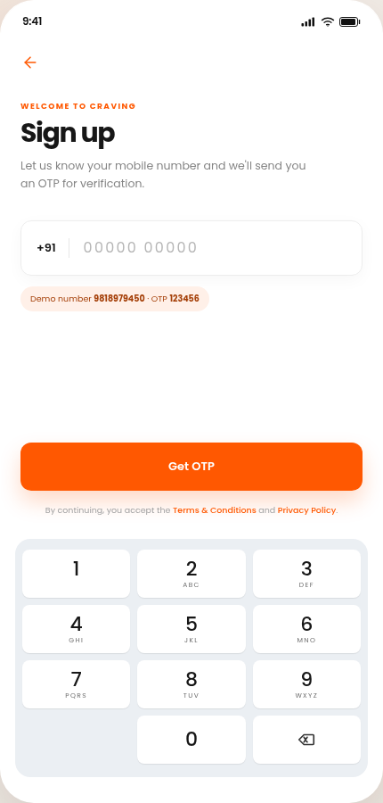
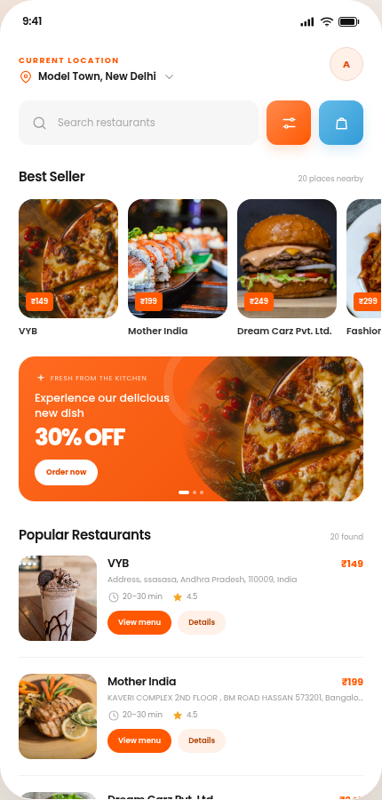
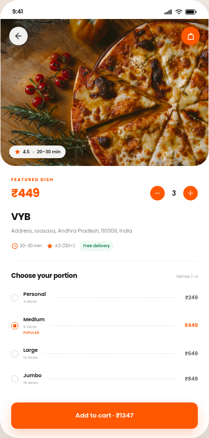
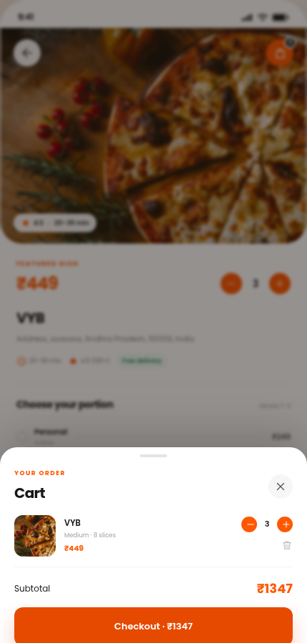

# Craving Web

A mobile-first restaurant discovery app built with React and Vite. It supports OTP authentication, restaurant browsing, search, restaurant details, and a demo cart.

**Live demo:** [craving-web.vercel.app](https://craving-web.vercel.app)

## Demo access

The staging API accepts the following demo account:

```text
Mobile: 9818979450
OTP:    123456
```

The login and OTP screens also include one-tap demo buttons.

## Preview

| Login | Home |
|---|---|
|  |  |

| Restaurant detail | Cart |
|---|---|
|  |  |

## Screens

- **Login** — mobile number entry with a custom keypad.
- **Verification** — six-digit OTP entry, 30-second resend timer, and validation states.
- **Home** — location header, search, Best Seller carousel, promotional banner, and a popular-restaurants list.
- **Restaurant detail** — hero image, quantity selector, portion options, and Add to Cart.
- **Cart** — quantity controls, subtotal, item removal, and a demo checkout.

The layout is presented inside a phone frame on desktop and becomes a full-screen mobile layout below 520px.

## Stack

- React 19
- Vite 6
- React Router 7
- Plain CSS with design tokens
- Browser `fetch` for API requests

No UI component library is used.

## Run locally

```bash
cd frontend
npm install
npm run dev
```

Open `http://localhost:5173`.

Optional environment configuration:

```bash
cp .env.example .env
```

`VITE_API_BASE_URL` defaults to the provided staging API.

Production build:

```bash
npm run build
npm run preview
```

## API integration

| Request | Use |
|---|---|
| `POST /v1/pwa/user/register` | Send an OTP for a mobile number |
| `POST /v1/pwa/user/login` | Verify the OTP and return a JWT |
| `GET /v1/m/restaurant?city_id=118` | Fetch restaurants for the home screen |

The JWT is stored in `localStorage` under `craving.session`. A route guard redirects unauthenticated visitors to the login screen. The restaurant request sends the token as `Authorization: Bearer <token>`.

## Project structure

```
frontend/
├── public/
│   ├── favicon.svg
│   └── images/
├── src/
│   ├── components/
│   │   ├── CartSheet.jsx
│   │   ├── Icons.jsx
│   │   ├── Keypad.jsx
│   │   ├── PhoneFrame.jsx
│   │   ├── SmartImage.jsx
│   │   └── StatusBar.jsx
│   ├── lib/
│   │   ├── api.js
│   │   ├── auth.jsx
│   │   ├── cart.jsx
│   │   ├── data.js
│   │   └── restaurants.jsx
│   ├── pages/
│   │   ├── HomePage.jsx
│   │   ├── LoginPage.jsx
│   │   ├── RestaurantPage.jsx
│   │   └── VerifyPage.jsx
│   ├── App.jsx
│   ├── main.jsx
│   └── styles.css
├── index.html
├── package.json
└── vite.config.js
```

## Notes

- Restaurant names and addresses come from the API.
- Local food photography is used as a reliable fallback when an API logo is missing or unavailable.
- Cart contents persist across reloads in `localStorage`.
- Component styles include focus states, keyboard support for the OTP fields, and reduced-motion support.
- `npm audit` reports **0 vulnerabilities**.
